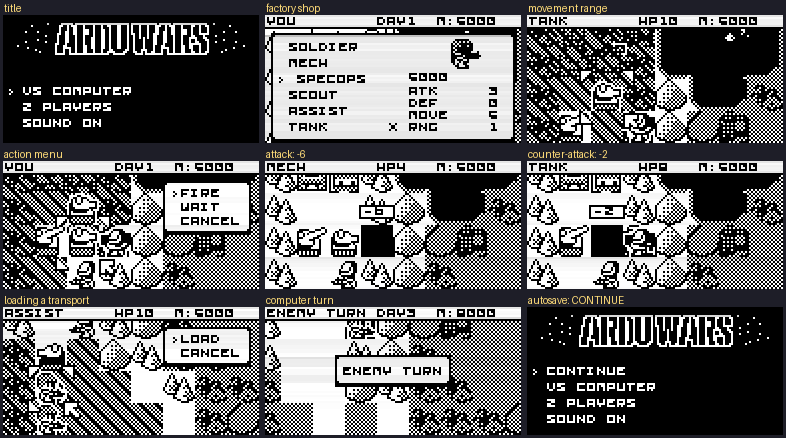

# Arduwars FX

An Advance Wars style strategy game for the **Arduboy FX-C** (and FX / Mini).
Based on [Arduwars](https://github.com/BotiKis/Arduwars) by Botond Kis, which
stopped in 2019 with movement, fog and the shop working but no combat,
capturing, win condition or computer opponent. This version finishes it.



### What's in it
* **Vs computer** and **2 players** on one Arduboy (pass it over between turns)
* 3 maps: Skirmish (12x12), Battle (20x12, with sea), Arduwars (24x16)
* **Battle scenes** like Advance Wars: both squads face off on their own terrain (one figure per 2 HP),
  the attacker fires, the defender's HP counts down as figures drop out, then the counter-attack. B skips.
* Units **drive and walk** to their new tile along their path, a tile at a time, with the camera following
* **The computer's turn plays out on screen**: you watch each enemy move and attack you can see.
  As in Advance Wars, an enemy walking through the fog vanishes and reappears as it crosses your sight
* Combat with counter-attacks, terrain defence, health shown on damaged units
* Artillery, rockets, missiles and battleships fire from range (2 tiles and up) but can't move and fire in the same turn
* Infantry captures buildings (20 points, a unit knocks off its health each turn)
* Win by taking the enemy HQ or destroying all their units; a draw after day 99
* Transports: the Assist truck and the Transport ship carry one infantry unit (LOAD, then DROP next to them)
* The Assist truck repairs neighbours by 1 HP each turn, units on your own buildings repair 2 HP
* A unit parked on a Science Lab removes the fog of war for you
* Fog of war, as in the original
* **Autosave** at the start of every turn: CONTINUE on the title screen
* A few beeps (SOUND ON/OFF in the menu)

### Which file do I need?
The FX-C moved the flash chip's select line from SDA to the HWB pin (so the link
cable can use I2C), so FX games need a separate build for it:

| Device | Files |
|---|---|
| **Arduboy FX-C**, Arduboy Mini | `build/ArduwarsFX-FXC.arduboy`, or `ArduwarsFX-FXC.hex` + `fxdata.bin` |
| Arduboy FX (and an Arduboy with the FX mod chip) | `build/ArduwarsFX-FX.arduboy`, or `ArduwarsFX-FX.hex` + `fxdata.bin` |

The FX build shows a blank screen on an FX-C, and the FX-C build does the same on an FX.

### Installing
The release builds leave out the USB stack to make room, so a PC can't reset the
Arduboy into upload mode by itself: **hold DOWN while switching it on** (or
switch on into the FX cart menu) before uploading. Adding it to a cart is unchanged.

* **Without touching your game cart:** upload the `.hex` as a sketch and
  `fxdata.bin` as development data, e.g. with MrBlinky's
  [Arduboy Python Utilities](https://github.com/MrBlinky/Arduboy-Python-Utilities):
  `python uploader.py ArduwarsFX-FXC.hex` then `python fxdata-upload.py fxdata.bin`.
  The Arduboy Toolset does the same from a GUI. The game then runs until you
  pick another game from the cart menu.
* **Adding it to the cart:** add the `.arduboy` file in a cart builder / the
  web uploader and write the cart. For the FX-C use the variant meant for
  devices with the flash select on PE2/HWB (the Mini cart).
* **Emulator:** the `.arduboy` files open in Ardens and ProjectABE. For the
  FX-C build, set the emulator to Arduboy Mini wiring if it doesn't pick it up.

### Controls


* **D-pad** moves the cursor. Hold **A** to scroll faster.
* **B** on one of your units picks it up and shows where it can go; **B** on a
  highlighted tile opens its actions: FIRE, CAPTURE, LOAD, DROP, WAIT, CANCEL.
* When firing or dropping, the D-pad jumps between the possible targets.
* **B** on a free factory, airport or shipyard opens the shop.
* **B** anywhere else: END TURN / CANCEL / QUIT (your autosave stays).
* **A** cancels / goes back.
* The top bar shows the unit under the cursor and its HP, or the day and your funds.

### Status
Played and tested in the Ardens emulator, not yet on a real FX-C:
computer vs computer games to the end on all three maps (the 20x12 Battle map
tends to stall into a day 99 draw between two computer players), scripted
human turns for buying, moving, firing, counter-attacks, artillery, capturing,
loading and dropping, 2 player hand-over and save/continue. At its deepest
the stack stays about 100 bytes clear of the game's variables.

Not done / known limits:
* The computer sees through the fog, buys no transports and never loads units.
* An enemy hidden in the fog still blocks your path (so moving reveals it a little).
* 20 units per side, 24 buildings per map, maps up to 384 tiles (24x16).

### How it fits (ATmega32u4: 28,672 bytes flash, 2,560 bytes RAM)
|  | Flash | RAM |
|---|---|---|
| original (art in program memory, no combat/capture/AI) | 25,790 | 1,509 + 768 map |
| Arduwars FX 1.0 | 27,750 | 2,227 (map included) |
| Arduwars FX 1.1 (battle scenes, movement, enemy turns; no USB stack) | 27,086 | 2,089 |

All the art, both fonts and the maps (7 KB) moved to the FX chip, which paid
for the rules, the computer player and the save. Other things that made room:
bitfields that don't straddle bytes, a byte-wise rectangle fill (Arduboy2's
draws pixel by pixel and was a third of the frame time), no Tinyfont or
Print code (text is drawn from the FX chip), and no recursion in the movement
search.

### Building
Sketch: `ArduwarsFX/`. Libraries: Arduboy2 and ArduboyFX (both come with the
Arduboy homemade board package). Compile for the Arduboy / Leonardo. For the
FX-C, the ArduboyFX library has to be compiled with `CART_CS_HWB` defined:
pick the Mini / HWB option of your board package, or with arduino-cli:

```
arduino-cli compile -b <your arduboy fqbn> --build-property "compiler.cpp.extra_flags=-DCART_CS_HWB" ArduwarsFX
```

`tools/make_release.sh` builds both versions and the `.arduboy` files.
The art and maps are in `ArduwarsFX/fxdata/` (PNGs and `fxdata.txt`). After
changing them, run MrBlinky's `fxdata-build.py fxdata.txt` there.
`tools/extract_assets.py` is what turned the original PROGMEM arrays into
those PNGs. The test rig is in `tools/emulator-test/`.

Maps in `fxdata.txt`: width, height, P1 starting city x y, P1 factory x y,
P2 city x y, P2 factory x y, then the tile numbers (same tile set as the Tiled
files in `Assets/MapData`).

---

### Story
There has been peace for many years in our lands until the evil forces of *Nextgenia* have invaded our country. Equipped with never before seen weapons their Army fearlessly takes over our lands.

*Cpt. Eidbit*, it is your mission to recover our lands and stop the great evil once for all. You are the commander of our army which you have lead to victory 🏁.


---


### Gameplay
Arduwars is a port of [Advance Wars](https://en.wikipedia.org/wiki/Advance_Wars) for the [Arduboy](https://arduboy.com/).
It is a turn based strategy game where the Players goal is to overtake the enemies Headquarters or destroy all his units.

Every turn, the Player commands his *Units* to capture *Buildings* or fight enemy Units. The key to winning is to use the environment strategically for your benefit. Certain terrain grants a bonus for defense or costs more movement. Buildings need to be captured to build more Units and get more income.

The Goal is to either capture the *Nextgenians* Headquarters or destroy all their units.


### How to play

#### Battle system
Every unit can be moved a certain distance. After a unit has been moved, it may attack or capture a building. Only infantry units can capture Buildings and not every unit can attack after it has moved.

Units that can attack, do so either directly (can attack adjacent to another unit where standing or moved, but be counter-attacked by the enemy unit), or in-directly (must remain still to attack, and have an enemy in firing range).

All unit traits are listed in the Units-section.


#### Terrain
Sprite  |  Name   |  Description
--|--|--
![terrain][terrain-plains]    |  Plains     |   Basic Terrain with no special effect.
![terrain][terrain-street]    |  Streets    |   Since movement is easier on paved Roads, Streets grant a small mobility bonus.
![terrain][terrain-forrest]   |  Forrests   |   Forrest grant a small defensive bonus but it is harder to move through them.
![terrain][terrain-hill]      |  Hills      |   Only Infantry Units can pass hills and they do that slowly. In return they provide a significant defense bonus.
![terrain][terrain-mountain]  |  Mountains  |   Only Infantry Units can pass Mountains and they do that very slowly. In return they provide a hughe defense bonus.
![building][building-city]    |  Buildings  |   Buildings are strategic locations in war. They grant different options. See the buildings section for more information.
![terrain][terrain-water]     |  Water      |   Water can only be accessed by Ships and Planes.
![terrain][terrain-reef]      |  Reefs      |   Reefs are a dangerous area for ships and must be avoided.


#### Buildings

Sprite  |  Name   |  Description
--|--|--
![building][building-city]      |  Cities                   |   Cities are the foundation of a nation. When occupied, they share a regular income of 1000 coins at the start of every round.
![building][building-factory]   |  Factories                |   Factories are needed to build new Land Units. Every occupied Factory can produce one Unit if there is no unit stationed above.
![building][building-airport]   |  Airports                 |   Airports are needed to build new Air Units. Every occupied Airport can produce one Unit if there is no unit stationed above.
![building][building-shipyard]  |  Shipyards                |   Shipyards are needed to build new Naval Units. Every occupied Shipyard can produce one Unit if there is no unit stationed above.
![building][building-lab]       |  Laboratories             |   There are numerous scientific Facilities located in our lands. When a Unit is stationed there they provide live satellite imagery which cancels the fog of war.
![building][building-hq1]       |  Players HQ               |   This is our Headquarters. Defend it by any means.
![building][building-hq2]       |  Nextgenias Headquarter   |   This are the Headquarters of the Nextgenians. If you can occupy this heavily fortified buildings you immediately win the battle.


#### Units
Sprite  |  Name   |  Description
--|--|--
![unit][unit-soldier]         |  Soldier        | Basic Infantry Unit. Weakest of all units but key for a strategic win. Only Infantry can occupy Buildings and move on Hills and Mountains.
![unit][unit-mech]            |  Mech           | Potent Infantry Unit which deal good damage to armored Units.
![unit][others-questionsmark] |  ???            | Every Army has secret and well trained Special-Operations Unit.
![unit][unit-scout]           |  Scout          | A light vehicle with high mobility.
![unit][unit-support]         |  Support        | This vehicle can transport Infantry Units and restores 1 Healthpoint of any adjacent Unit at the start of the turn. This Unit can not attack.
![unit][unit-tank]            |  Tank           | Powerful armored vehicle with good mobility.
![unit][others-questionsmark] |  ???            | Our engineers have created a powerful Unit for desperate times.
![unit][unit-artillery]       |  Artillery      | Long range unit that can deal small damage. May not move and attack in the same round.
![unit][unit-rocket]          |  Rocket         | Long range unit that can deal medium damage to Air and Marine Units. May not move and attack in the same round.
![unit][others-questionsmark] |  ???            | What may this weapon be?
![unit][unit-heli]            |  Helicopter     | Basic Air Unit. Can attack all other classes but only deals a small amount of damage.
![unit][unit-fighter]         |  Fighter        | Powerful Air Unit which can only attack other Air Units.
![unit][others-questionsmark] |  ???            | They call it **Fear of the Skies**.
![unit][unit-transportship]   |  Transportship  | A Ship that can load Infantry Units and move them over long distances in water. This Unit can not attack.
![unit][unit-cruiser]         |  Cruiser        | This well armed Ship can destroy all other ships easily but cannot attack anything else.
![unit][others-questionsmark] |  ???            | One of our most powerful weapons far outside on the sea.


#### Unit changes in the FX version
Movement now costs terrain points (forest 2 for vehicles, hills and mountains
are infantry only and cost more for soldiers). To make up for that a few units
got 1 more move: Tank 5, BigTank 3, Artillery 4, Rocket 4, Heli 6, Bomber 5,
Cruiser 5. The Assist and the Transport move 6. Ranged units fire at 2 to 3
(Artillery), 2-4 (Rocket, Battleship) and 2-5 (Missiles). Artillery, the
Bomber and the Battleship hit ground and sea but not aircraft, so Fighters,
Rockets and Missiles have a job. Damage = attack power and the attacker's
health against the defender's armour plus terrain, so a hurt unit hits less
hard.


## Do you like Arduwars?
Arduwars is free and should never be monetized.
Anyhow I would appreciate any little donation if you think this game was worth playing.

[](https://paypal.me/BotiKis)


[//]: # (image references here)
[terrain-forrest]: Assets/ReadmeAssets/terrainAndBuildings/terrain-forrest.png "terrain-forrest"
[terrain-hill]: Assets/ReadmeAssets/terrainAndBuildings/terrain-hill.png "terrain-hill"
[terrain-mountain]: Assets/ReadmeAssets/terrainAndBuildings/terrain-mountain.png "terrain-mountain"
[terrain-plains]: Assets/ReadmeAssets/terrainAndBuildings/terrain-plains.png "terrain-plains"
[terrain-reef]: Assets/ReadmeAssets/terrainAndBuildings/terrain-reef.png "terrain-reef"
[terrain-street]: Assets/ReadmeAssets/terrainAndBuildings/terrain-street.png "terrain-street"
[terrain-water]: Assets/ReadmeAssets/terrainAndBuildings/terrain-water.gif "terrain-water"

[building-airport]: Assets/ReadmeAssets/terrainAndBuildings/building-airport.png "building-airport"
[building-city]: Assets/ReadmeAssets/terrainAndBuildings/building-city.png "building-city"
[building-factory]: Assets/ReadmeAssets/terrainAndBuildings/building-factory.png "building-factory"
[building-hq1]: Assets/ReadmeAssets/terrainAndBuildings/building-headquarter1.png "building-hq1"
[building-hq2]: Assets/ReadmeAssets/terrainAndBuildings/building-headquarter2.png "building-hq2"
[building-lab]: Assets/ReadmeAssets/terrainAndBuildings/building-lab.png "building-lab"
[building-shipyard]: Assets/ReadmeAssets/terrainAndBuildings/building-shipyard.png "building-shipyard"


[//]: # (Unit image references here)
[unit-artillery]: Assets/ReadmeAssets/unitgifs/unit-artillery.gif "unit-artillery"
[unit-battleship]: Assets/ReadmeAssets/unitgifs/unit-battleship.gif "unit-battleship"
[unit-bigtank]: Assets/ReadmeAssets/unitgifs/unit-bigtank.gif "unit-bigtank"
[unit-bomber]: Assets/ReadmeAssets/unitgifs/unit-bomber.gif "unit-bomber"
[unit-cruiser]: Assets/ReadmeAssets/unitgifs/unit-cruiser.gif "unit-cruiser"
[unit-fighter]: Assets/ReadmeAssets/unitgifs/unit-fighter.gif "unit-fighter"
[unit-heli]: Assets/ReadmeAssets/unitgifs/unit-heli.gif "unit-heli"
[unit-mech]: Assets/ReadmeAssets/unitgifs/unit-mech.gif "unit-mech"
[unit-missiles]: Assets/ReadmeAssets/unitgifs/unit-missiles.gif "unit-missiles"
[unit-rocket]: Assets/ReadmeAssets/unitgifs/unit-rocket.gif "unit-rocket"
[unit-scout]: Assets/ReadmeAssets/unitgifs/unit-scout.gif "unit-scout"
[unit-soldier]: Assets/ReadmeAssets/unitgifs/unit-soldier.gif "unit-soldier"
[unit-specops]: Assets/ReadmeAssets/unitgifs/unit-specops.gif "unit-specops"
[unit-support]: Assets/ReadmeAssets/unitgifs/unit-support.gif "unit-support"
[unit-tank]: Assets/ReadmeAssets/unitgifs/unit-tank.gif "unit-tank"
[unit-transportship]: Assets/ReadmeAssets/unitgifs/unit-transportship.gif "unit-transportship"
[others-questionsmark]: Assets/ReadmeAssets/questionsmarks.gif "others-questionsmark"
